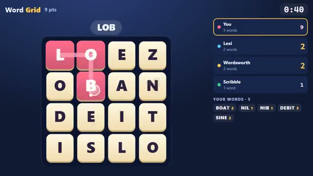

# Word Grid

One grid of letters. Two minutes. Find more words. A multiplayer starter game from [Multiplayer Agent](https://multiplayeragent.com): 2D, versus, 2–8 players, with bots that fill empty seats.

## How it plays

Everyone gets the same grid of letters. Drag across touching letters to make words of 3 or more: longer words score more, but a word someone else found too scores only half at the end.

**Controls:** Drag across the letters with the mouse or a finger; on a keyboard you can also type a word and press Enter.

## Make it yours in the Game Builder

Open the [Game Builder](https://multiplayeragent.com), choose **Start from a starter game** and pick Word Grid. It opens as version 1 in your studio, ready to play and publish. Then ask for changes, for example:

- Make it a 5×5 grid with a 3-minute round
- Add a bonus tile that doubles the word it's in
- Show a fireworks burst when someone finds a 7-letter word

## Run it yourself

1. Get a free publishable key (`pk_…`) at [multiplayeragent.com](https://multiplayeragent.com).
2. In `index.html`, put it in place of `pk_REPLACE_ME` in the `MP_CONNECT` block.
3. Open `index.html` in a browser. No build step and no server needed.

Without a key it still runs, offline against bots.

## How it is built

- One `index.html`. The comment at the top of the main script maps the code and explains the multiplayer. The word list (about 4,800 words, plus their plurals) sits in its own small script block above it: add or remove words there.
- **Host-run rounds:** One player's browser deals the grid, runs the clock and adds up the scores; if it leaves, the next player takes over.
- **Leaderboard:** Each player's best round score.
- **Bots:** Bot players hunt for words alongside you until enough people join.
- **Live sync:** Everyone's word count and points climb on every screen as they play.
- **Live ops:** Change the grid size (4×4 or 5×5) or the round length for every room without touching code.
- `?attract` runs it offline with bots and an autopilot for you. The preview video is recorded from it.

## License

MIT.
